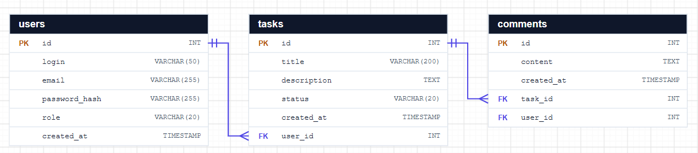

# FUN – Task Manager


Internetowy system zarządzania zadaniami, przygotowany podczas praktyk zawodowych INF.03.

## Cel projektu

FUN to prosta aplikacja w stylu tablicy Trello. Użytkownik zapisuje zadania, widzi je w trzech kolumnach (**Nowe**, **W trakcie**, **Zakończone**), zmienia ich status, edytuje je i usuwa. Dane są zapisywane w bazie PostgreSQL, a strona komunikuje się z bazą wyłącznie przez API.

Celem projektu jest przejście całego cyklu tworzenia aplikacji: od wymagań i repozytorium, przez projekt bazy danych, aż po działający frontend i backend.

## Funkcje

| Funkcja | Stan |
|---|---|
| Lista zadań pobierana z bazy przez API (tablica z 3 kolumnami) | gotowe |
| Dodawanie zadania z walidacją (tytuł wymagany, maks. 200 znaków) | gotowe |
| Edycja zadania i zmiana statusu | gotowe |
| Usuwanie zadania z potwierdzeniem | gotowe |
| Komunikaty o sukcesie i błędach (brak połączenia, złe dane, brak rekordu) | gotowe |
| Układ responsywny (telefon 390 px i komputer 1280 px) | gotowe |
| Filtrowanie i wyszukiwanie po tekście | planowane |
| Logowanie i role użytkowników | planowane |

## Technologie

| Część | Technologie |
|---|---|
| Frontend | HTML5, CSS3 (Flexbox, Grid, zmienne CSS), JavaScript (`fetch`, `async/await`) |
| Backend | ASP.NET Core Web API (.NET 10), Entity Framework Core, Npgsql |
| Baza danych | PostgreSQL, pgAdmin 4 |
| Repozytorium i CI | Git, GitHub, GitHub Actions (sprawdzanie HTML, CSS i JS) |
| Narzędzia | Visual Studio / VS Code, DevTools, Postman |

## Struktura repozytorium

```text
FUN/
├── .github/workflows/ci.yaml   # CI: html-validate, stylelint, node --check
├── backend/                    # ASP.NET Core Web API (TaskManager.Api)
├── database/                   # skrypty SQL: tabele, dane testowe, zapytania, role
├── docs/                       # diagram ERD, makiety, paleta, backup, uprawnienia
├── frontend/                   # index.html, css/style.css, js/app.js, assets/
├── postman/                    # pliki Postmana (testy API)
└── tools/mock-api/             # testowe API w Node.js (bez bazy danych)
```

## Baza danych



Trzy tabele połączone kluczami obcymi:

- `users` – użytkownicy (login i e-mail są unikalne, hasło tylko jako `password_hash`),
- `tasks` – zadania, `user_id` → `users.id`, status tylko `new`, `in_progress` albo `done` (`CHECK`),
- `comments` – komentarze, `task_id` → `tasks.id` (`ON DELETE CASCADE`), `user_id` → `users.id`.

Skrypty w katalogu `database/` uruchamia się w tej kolejności:

| Plik | Co robi |
|---|---|
| `table-schema.sql` | tworzy tabele z kluczami i ograniczeniami |
| `insert-data.sql` | dane testowe: 5 użytkowników, 7 zadań, 8 komentarzy; klucze obce pobierane podzapytaniami (bez wpisywania id ręcznie) |
| `select-training.sql` | przykładowe zapytania `SELECT`, `GROUP BY`, `JOIN` |
| `create-user-select.sql` | rola `userek` z uprawnieniem tylko do odczytu |
| `test-user-select.sql` | test uprawnień roli `userek` |

Kopia zapasowa i odtwarzanie: [docs/backup-restore.docx](docs/backup-restore.docx).
Użytkownicy i uprawnienia: [docs/uzytkownicy-uprawnienia.docx](docs/uzytkownicy-uprawnienia.docx).

## Uruchomienie

### Wymagania

- PostgreSQL 16 lub nowszy (z pgAdmin 4),
- .NET 10 SDK (albo Visual Studio 2026 z obsługą ASP.NET),
- Git,
- przeglądarka (Chrome, Edge, Firefox).

### 1. Pobranie projektu

```bash
git clone https://github.com/zakharherun/FUN.git
cd FUN
```

### 2. Baza danych

W pgAdmin: **Databases → Create → Database…**, nazwa `taskmanager-db`. Potem na tej bazie **Query Tool** i uruchom po kolei `database/table-schema.sql` oraz `database/insert-data.sql`.

Albo w terminalu:

```bash
psql -U postgres -c "CREATE DATABASE \"taskmanager-db\""
psql -U postgres -d taskmanager-db -f database/table-schema.sql
psql -U postgres -d taskmanager-db -f database/insert-data.sql
```

### 3. Połączenie backendu z bazą

Skopiuj plik `backend/TaskManager.Api/appsettings.Local.example.json` jako `backend/TaskManager.Api/appsettings.Local.json` i w miejsce `HASLO` wpisz hasło użytkownika `postgres`:

```json
{
  "ConnectionStrings": {
    "TaskManagerDb": "Host=localhost;Port=5432;Database=taskmanager-db;Username=postgres;Password=HASLO"
  }
}
```

Plik `appsettings.Local.json` jest w `.gitignore`, więc hasło nie trafia do repozytorium.

### 4. Uruchomienie backendu

Visual Studio: otwórz `backend/TaskManager.slnx`, wybierz profil **http** i uruchom (F5).

Albo w terminalu:

```bash
cd backend
dotnet run --project TaskManager.Api --launch-profile http
```

### 5. Aplikacja

Otwórz **http://localhost:5113/**. Backend w trybie Development serwuje też stronę z katalogu `frontend/`.

Sprawdzenie połączenia z bazą: http://localhost:5113/api/health/db powinno zwrócić `{"database":"ok"}`.

### Bez bazy danych (tylko podgląd frontendu)

Testowe API w Node.js trzyma dane w pamięci i działa na tym samym porcie co backend:

```bash
PORT=5113 node tools/mock-api/server.js
```

Szczegóły: [tools/mock-api/README.md](tools/mock-api/README.md).

### Typowe problemy

| Objaw | Przyczyna |
|---|---|
| „Brak połączenia z serwerem” | backend nie działa albo `API_URL` w `frontend/js/app.js` wskazuje inny port niż 5113 |
| `password authentication failed for user "postgres"` | złe hasło w `appsettings.Local.json` |
| `database "taskmanager-db" does not exist` | nie utworzono bazy (krok 2) |
| `relation "tasks" does not exist` | nie uruchomiono `table-schema.sql` |
| stara wersja strony po zmianach | odśwież z pominięciem pamięci podręcznej: **Ctrl+F5** |

## API

| Metoda | Adres | Odpowiedź |
|---|---|---|
| GET | `/api/tasks` | 200 + lista zadań |
| GET | `/api/tasks/{id}` | 200 lub 404 |
| POST | `/api/tasks` | 201 + nowe zadanie lub 400 |
| PUT | `/api/tasks/{id}` | 200, 400 lub 404 |
| PATCH | `/api/tasks/{id}/status` | 200, 400 lub 404 |
| DELETE | `/api/tasks/{id}` | 204 lub 404 |
| GET | `/api/health`, `/api/health/db` | stan API i połączenia z bazą |

Pełna lista (również komentarze i użytkownicy): [backend/README.md](backend/README.md). Przykładowe żądania: `backend/TaskManager.Api/TaskManager.Api.http`.

## Bezpieczeństwo

- Hasło do bazy jest tylko w lokalnym pliku `appsettings.Local.json` (w `.gitignore`).
- Frontend łączy się wyłącznie z API, nigdy bezpośrednio z bazą.
- Dane z API są wstawiane na stronę przez `textContent`, nie `innerHTML` (ochrona przed XSS).
- Backend korzysta z Entity Framework Core, który wysyła zapytania z parametrami (ochrona przed SQL Injection).
- Walidacja danych jest w trzech miejscach: HTML (`required`, `maxlength`), JavaScript i backend; baza dodatkowo pilnuje kluczy i ograniczeń `CHECK`.
- W bazie przechowywany jest tylko hash hasła; API nigdy nie zwraca pola `password_hash`.
- W repozytorium są wyłącznie fikcyjne dane testowe.

## Praca z Git

- Gałąź `main` jest chroniona (ruleset): zmiany trafiają do niej tylko przez Pull Request.
- Każda zmiana powstaje na osobnej gałęzi, np. `feature/frontend-crud`, `feature/backend-api`.
- Przy każdym pushu i Pull Requeście GitHub Actions sprawdza HTML, CSS i JavaScript.

## Dokumentacja

- [docs/design.md](docs/design.md) – makiety, paleta kolorów, czcionki, logo, ikony,
- [docs/diagram-erd.png](docs/diagram-erd.png) – diagram ERD,
- [docs/backup-restore.docx](docs/backup-restore.docx) – kopia zapasowa i odtwarzanie bazy,
- [docs/uzytkownicy-uprawnienia.docx](docs/uzytkownicy-uprawnienia.docx) – role i uprawnienia,
- [backend/README.md](backend/README.md) – backend i wszystkie endpointy,
- [frontend/README.md](frontend/README.md) – założenia frontendu.

## Autor

Zakhar Herun
