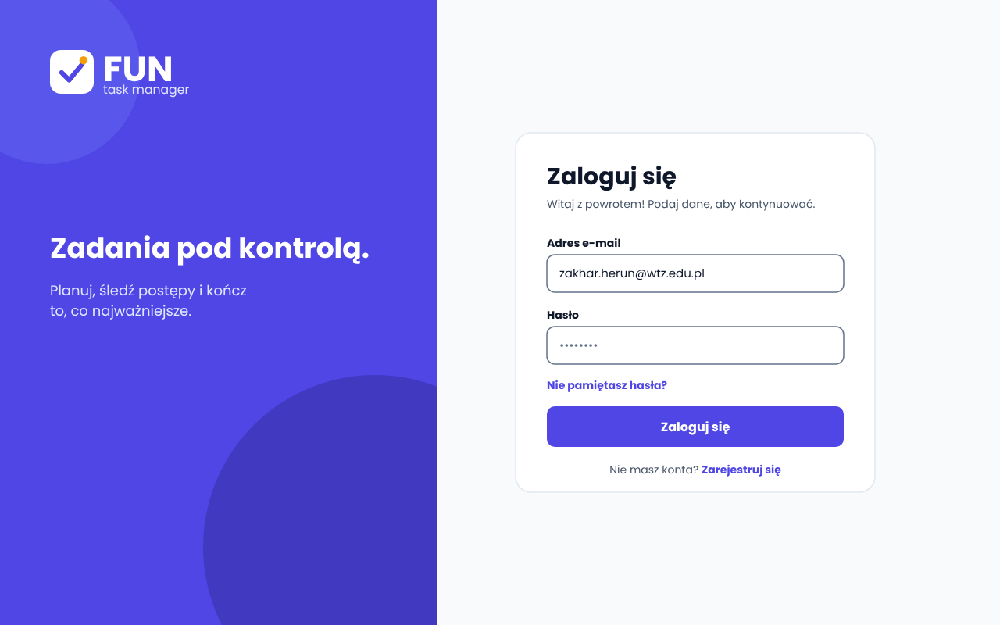
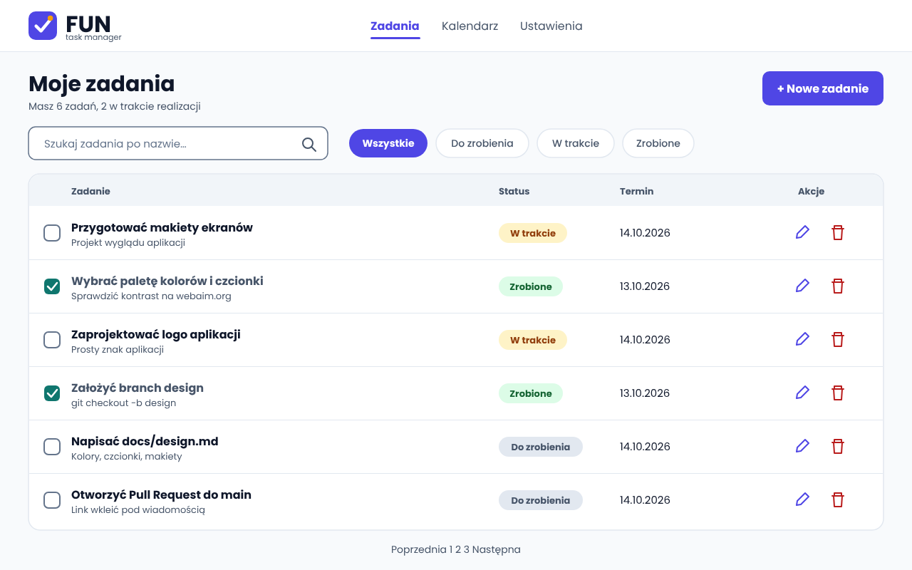
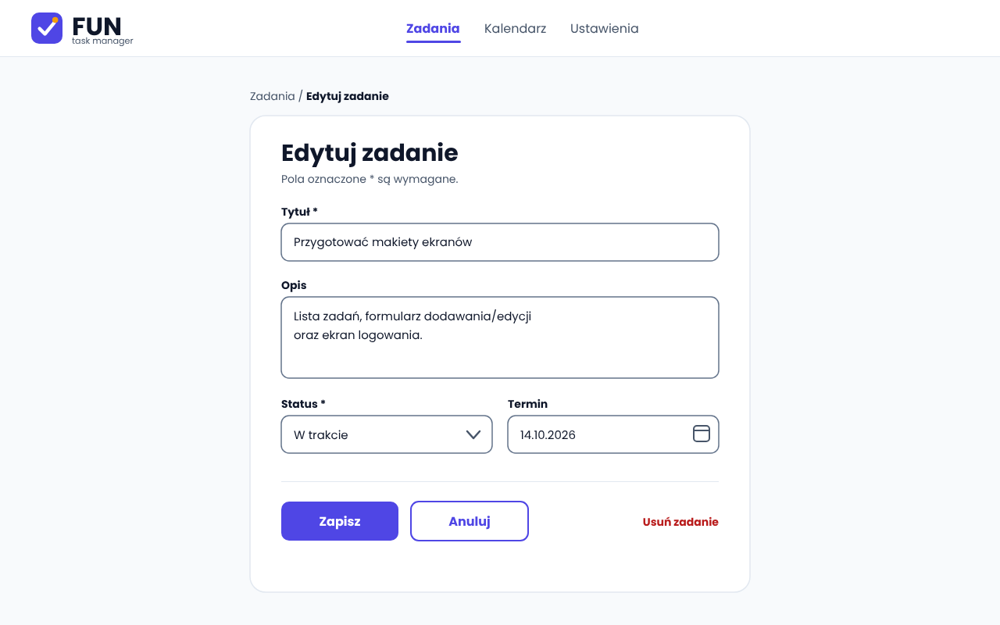
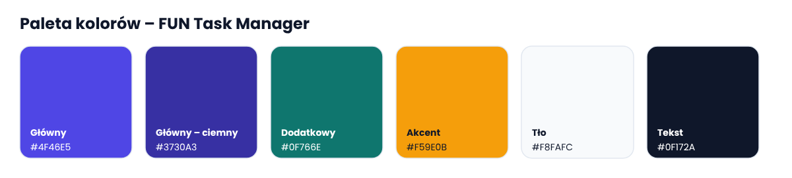

# Projekt wyglądu aplikacji – FUN Task Manager

Dokument opisuje warstwę wizualną aplikacji do zarządzania zadaniami: makiety ekranów, paletę kolorów, czcionki i logo.

## 1. Makiety ekranów

Makiety wykonano w formacie PNG, widok desktop 1280 × 800 px.

| Ekran | Plik | Cel |
|---|---|---|
| Logowanie | [01-logowanie.png](mockups/01-logowanie.png) | Wejście do aplikacji (e-mail + hasło) |
| Lista zadań | [02-lista-zadan.png](mockups/02-lista-zadan.png) | Przegląd, wyszukiwanie i filtrowanie zadań |
| Formularz zadania | [03-formularz-zadania.png](mockups/03-formularz-zadania.png) | Dodawanie i edycja zadania |

### 1.1 Ekran logowania


- Lewy panel w kolorze głównym z logo i sloganem „Zadania pod kontrolą.”, prawy panel z kartą formularza.
- Pola: adres e-mail, hasło. Przycisk główny „Zaloguj się”.
- Linki pomocnicze: „Nie pamiętasz hasła?” i „Zarejestruj się”.

### 1.2 Lista zadań


- Nagłówek z logo i nawigacją (Zadania, Kalendarz, Ustawienia); aktywna pozycja jest podkreślona kolorem głównym.
- Podtytuł z licznikiem zadań („Masz 6 zadań, 2 w trakcie realizacji”).
- Wyszukiwarka po nazwie oraz filtry statusu: Wszystkie / Do zrobienia / W trakcie / Zrobione (zgodnie z funkcjami z README).
- Kolumny tabeli: Zadanie, Status, Termin, Akcje. Każdy wiersz zawiera checkbox, tytuł, krótki opis, status w postaci plakietki, termin oraz ikony akcji (edytuj, usuń).
- Zadania ze statusem „Zrobione” mają zaznaczony checkbox i przygaszony tytuł.
- Pod tabelą znajduje się paginacja (Poprzednia / numery stron / Następna).
- Przycisk „+ Nowe zadanie” w prawym górnym rogu otwiera formularz.

### 1.3 Formularz dodawania / edycji zadania


- Makieta pokazuje widok **edycji** (ścieżka „Zadania / Edytuj zadanie”). Ten sam formularz służy do dodawania: wtedy tytuł brzmi „Nowe zadanie”, pola są puste, a link „Usuń zadanie” nie jest wyświetlany.
- Pola: Tytuł (wymagane), Opis (pole wielolinijkowe), Status (lista rozwijana, wymagane), Termin (data z ikoną kalendarza).
- Przyciski: „Zapisz” (główny, wypełniony) i „Anuluj” (drugorzędny, z obramowaniem). Po prawej link „Usuń zadanie” w kolorze błędu.

## 2. Paleta kolorów



| Rola | Nazwa | HEX | Zastosowanie |
|---|---|---|---|
| Główny | Indygo | `#4F46E5` | Przyciski główne, aktywne elementy, linki |
| Główny – ciemny | Głębokie indygo | `#3730A3` | Stan hover/focus przycisków, dekoracje panelu logowania |
| Dodatkowy | Morski | `#0F766E` | Zaznaczone checkboxy, akcenty pomocnicze |
| Akcent | Bursztyn | `#F59E0B` | Detal w logo, drobne wyróżnienia (nie dla tekstu na białym) |
| Tło | Jasny szary | `#F8FAFC` | Tło strony |
| Powierzchnia | Biały | `#FFFFFF` | Karty, pola formularzy |
| Tekst | Granat | `#0F172A` | Tekst podstawowy i nagłówki |
| Tekst pomocniczy | Szarość | `#475569` | Opisy, etykiety drugorzędne |
| Obramowanie | Szarość jasna | `#E2E8F0` | Linie i ramki kart, separatory wierszy |
| Obramowanie pól | Szarość średnia | `#64748B` | Ramki pól formularzy, wyszukiwarki i niezaznaczonych checkboxów; tekst zastępczy (placeholder) |
| Tło nagłówka tabeli | Szarość bardzo jasna | `#F1F5F9` | Wiersz nagłówka tabeli zadań |
| Tekst na kolorze głównym | Lawenda | `#E0E7FF` | Slogan i podpis logo na panelu logowania |
| Błąd / usuwanie | Czerwień | `#B91C1C` | Akcja usuń, komunikaty błędów |

Kolory statusów zadań:

| Status | Tło | Tekst |
|---|---|---|
| Do zrobienia | `#E2E8F0` | `#475569` |
| W trakcie | `#FEF3C7` | `#92400E` |
| Zrobione | `#DCFCE7` | `#166534` |

### 2.1 Kontrast tekstu do tła (WCAG)

Współczynniki kontrastu obliczono według wzoru WCAG 2.x (taki sam wynik daje webaim.org/resources/contrastchecker). Wymagane minimum dla zwykłego tekstu: **4,5 : 1** (AA), dla AAA: 7 : 1.

| Tekst | Tło | Kontrast | Wynik |
|---|---|---|---|
| `#0F172A` | `#F8FAFC` | 17,06 : 1 | AAA |
| `#0F172A` | `#FFFFFF` | 17,85 : 1 | AAA |
| `#475569` | `#F8FAFC` | 7,24 : 1 | AAA |
| `#FFFFFF` | `#4F46E5` (przycisk) | 6,29 : 1 | AA |
| `#FFFFFF` | `#3730A3` (hover) | 9,93 : 1 | AAA |
| `#4F46E5` | `#FFFFFF` (link) | 6,29 : 1 | AA |
| `#FFFFFF` | `#0F766E` | 5,47 : 1 | AA |
| `#B91C1C` | `#FFFFFF` | 6,47 : 1 | AA |
| `#64748B` | `#FFFFFF` (placeholder, ramki pól) | 4,76 : 1 | AA |
| `#475569` | `#F1F5F9` (nagłówek tabeli) | 6,92 : 1 | AA |
| `#E0E7FF` | `#4F46E5` (slogan) | 5,10 : 1 | AA |
| `#475569` | `#E2E8F0` (status) | 6,15 : 1 | AA |
| `#92400E` | `#FEF3C7` (status) | 6,37 : 1 | AA |
| `#166534` | `#DCFCE7` (status) | 6,49 : 1 | AA |

Wszystkie pary tekst/tło spełniają poziom AA. Bursztynowy `#F59E0B` nie jest używany jako kolor tekstu na jasnym tle (kontrast byłby za niski); z ciemnym tekstem `#0F172A` daje 8,31 : 1.

### 2.2 Zmienne CSS

```css
:root {
  --color-primary: #4F46E5;
  --color-primary-dark: #3730A3;
  --color-secondary: #0F766E;
  --color-accent: #F59E0B;
  --color-bg: #F8FAFC;
  --color-surface: #FFFFFF;
  --color-text: #0F172A;
  --color-text-muted: #475569;
  --color-border: #E2E8F0;
  --color-danger: #B91C1C;
}
```

## 3. Czcionki

| Zastosowanie | Czcionka | Grubości |
|---|---|---|
| Nagłówki, przyciski, logo | **Poppins** (Google Fonts) | 600, 700 |
| Treść, formularze, tabele | **Inter** (Google Fonts) | 400, 500 |

**Dlaczego te czcionki:**

- **Poppins** ma geometryczne, zaokrąglone kształty, które pasują do zaokrąglonych przycisków i kart oraz nadają aplikacji przyjazny charakter („FUN”). Pogrubione warianty są bardzo czytelne w nagłówkach.
- **Inter** została zaprojektowana z myślą o interfejsach ekranowych: ma wysoką czytelność w małych rozmiarach, wyraźnie odróżnia podobne znaki (I, l, 1) i dobrze wygląda w tabelach i polach formularzy.
- Obie obsługują **polskie znaki** (zestaw Latin Extended: ą, ć, ę, ł, ń, ó, ś, ź, ż).
- Para łączy dwa kroje bezszeryfowe o wyraźnym kontraście charakteru: ekspresyjny nagłówek i neutralna treść.
- Obie są darmowe (licencja SIL OFL) i dostępne w Google Fonts.

Osadzenie w HTML:

```html
<link rel="preconnect" href="https://fonts.googleapis.com">
<link rel="preconnect" href="https://fonts.gstatic.com" crossorigin>
<link href="https://fonts.googleapis.com/css2?family=Inter:wght@400;500&family=Poppins:wght@600;700&display=swap" rel="stylesheet">
```

```css
body { font-family: 'Inter', system-ui, sans-serif; font-size: 16px; line-height: 1.5; color: var(--color-text); }
h1, h2, h3, button { font-family: 'Poppins', system-ui, sans-serif; }
```

Skala rozmiarów (zgodna z makietami): slogan na ekranie logowania 36 px / tytuł ekranu lub karty (H1) 30 px / tytuły zadań i przyciski 16 px / treść pól formularza 15 px / etykiety i opisy 13–14 px.

## 4. Logo


Plik: [logo.png](logo/logo.png). Ta sama wersja jest dostępna dla aplikacji w [frontend/assets/logo.png](../frontend/assets/logo.png).

**Idea:** zaokrąglony kwadrat w kolorze głównym (`#4F46E5`) ze znakiem ✓ (zadanie wykonane) i bursztynową kropką (`#F59E0B`) jako „iskrą” radości (FUN). Napis „FUN” w Poppins Bold, podpis „task manager” w Poppins Regular. Znak jest prosty i czytelny nawet w małym rozmiarze (np. jako favicon).

## 5. Ikony

Ikony są w katalogu [frontend/assets](../frontend/assets), w formacie SVG, w siatce 24 × 24 px, o stałej grubości kreski 2 px i zaokrąglonych końcach (jednolity styl liniowy). Kolory pochodzą z palety: usuwanie `#B91C1C`, dodawanie `#4F46E5`, potwierdzenie `#0F766E`, pozostałe `#475569`.

| Ikona | Plik | Zastosowanie |
|---|---|---|
|  | `icon-add.svg` | Nowe zadanie |
|  | `icon-edit.svg` | Edycja zadania |
|  | `icon-delete.svg` | Usuwanie zadania |
|  | `icon-search.svg` | Wyszukiwarka |
|  | `icon-filter.svg` | Filtr statusu |
|  | `icon-calendar.svg` | Termin zadania |
|  | `icon-check.svg` | Zadanie zrobione |
|  | `icon-tasks.svg` | Lista zadań |
|  | `icon-comment.svg` | Komentarze |
|  | `icon-user.svg` | Profil użytkownika |
|  | `icon-settings.svg` | Ustawienia |
|  | `icon-logout.svg` | Wylogowanie |
|  | `icon-close.svg` | Zamknięcie okna |

Użycie w HTML: ``
